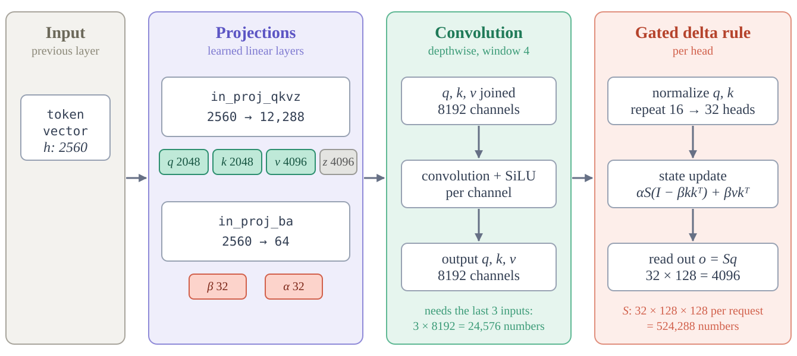
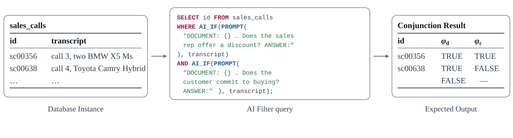

<aside class="tldr"><strong>TL;DR:</strong> What LLMs should an AI-SQL engine support to operate at scale? Different workloads require different models, so <a href="https://github.com/fsdatalab/quail">Quail</a> must support modern architectures beyond transformers. We now support hybrid models such as <a href="https://qwen.ai/blog?id=qwen3.5">Qwen3.5-4B</a>, which mix full-attention layers with linear-attention (Gated DeltaNet) layers. By storing KV for the attention layers and a checkpoint of the recurrent state for the GDN layers, Quail keeps its reuse optimizations on these models. On QUAIL-B, we observe a 5.5&times; improvement over vLLM on Qwen3.5-4B: the same queries, a fraction of the time! You can try out our <a href="#7-hybrid-playgrounds">interactive playgrounds</a> to explore how much a checkpoint costs and how the cost model prices a hybrid query.</aside>

<nav class="post-toc" aria-label="Table of contents">
<strong>Contents</strong>
<ol>
  <li><a href="#1-introduction">Introduction.</a></li>
  <li><a href="#2-gated-deltanet-vs-attention">Gated DeltaNet vs. Attention.</a>
    <ol>
      <li><a href="#21-attention">Attention.</a></li>
      <li><a href="#22-linear-attention-layer-gated-deltanet">Linear Attention Layer (Gated DeltaNet).</a></li>
      <li><a href="#23-short-convolution">Short Convolution.</a></li>
    </ol>
  </li>
  <li><a href="#3-checkpoints-in-quail">Checkpoints in Quail.</a>
    <ol>
      <li><a href="#31-checkpoint-size">Checkpoint Size.</a></li>
      <li><a href="#32-retaining-kv-and-checkpoints">Retaining KV and Checkpoints.</a></li>
      <li><a href="#33-eviction">Eviction.</a></li>
    </ol>
  </li>
  <li><a href="#4-updated-cost-model">Updated Cost Model.</a>
    <ol>
      <li><a href="#41-the-gated-delta-rule">The Gated Delta Rule.</a></li>
      <li><a href="#42-example-sales-4-on-qwen35-4b">Example: SALES-4 on Qwen3.5-4B.</a></li>
    </ol>
  </li>
  <li><a href="#5-results">Results.</a></li>
  <li><a href="#6-limitations-and-follow-ups">Limitations and Follow-ups.</a></li>
  <li><a href="#7-hybrid-playgrounds">Hybrid Playgrounds.</a>
    <ol>
      <li><a href="#71-checkpoint-playground">Checkpoint Playground.</a></li>
      <li><a href="#72-cost-model-playground">Cost-Model Playground.</a></li>
    </ol>
  </li>
</ol>
</nav>

# 1. Introduction

We have been hard at work building [Quail](https://fsdatalab.github.io/blog/introducing-quail/)<sup><a href="#note-1">1</a></sup>, our inference engine for AI functions in SQL. Most of Quail's speed comes from good scheduling and memory management of the KV cache. Instead of treating every document (i.e., row in a table) as an independent LLM request, Quail decides which documents to keep in the KV cache and reuses them across operators.

So far, Quail has only supported transformers like Qwen3<sup><a href="#note-2">2</a></sup>, where the KV cache grows linearly with document length and quickly fills GPU memory. Many new open-weight models, like Qwen3.5, are hybrids, which replace most attention layers with Gated DeltaNet (GDN)<sup><a href="#note-3">3</a></sup> layers, a type of linear attention. GDN layers keep a fixed-size state regardless of document length, which dramatically reduces memory for long documents (e.g., a 16,000-token document takes up 2.4 GB with Qwen3-4B but only 580 MB with Qwen3.5-4B). With less memory per document, Quail can keep more documents in memory.

It turns out that supporting hybrids in Quail is not that straightforward, because the way Quail reuses a document's KV cache does not carry over to GDN layers. In this post, we describe how we adapt Quail to hybrids using Qwen3.5-4B<sup><a href="#note-4">4</a></sup>. We explain GDN ([Section 2](#2-gated-deltanet-vs-attention)), add checkpoints of the GDN state to Quail's memory budget and eviction policy ([Section 3](#3-checkpoints-in-quail)), update the cost model ([Section 4](#4-updated-cost-model)), and compare with vLLM on QUAIL-B ([Section 5](#5-results)).

# 2. Gated DeltaNet vs. Attention

Gated DeltaNet (GDN) and attention behave in vastly different ways. Below, we describe the differences in what they retain, and briefly give an overview of both.

## 2.1 Attention

Attention compares each token with all earlier tokens, so the KV cache grows linearly with document length. Though grouped-query attention (GQA)<sup><a href="#note-5">5</a></sup> shrinks the KV cache, it is only by a constant factor. Quail relies on a "rewind" capability to persist only the document prefix that later operators reuse, so any model we support must allow some form of rewind for prefix caching.

## 2.2 Linear Attention Layer (Gated DeltaNet)

Next, we turn to linear attention layers, specifically Gated DeltaNet (GDN) and its recurrence formula. We illustrate the layer for Qwen3.5-4B.

Hybrid architectures combine both full-attention layers and linear attention layers. An example of linear attention layers is GDN layers in Qwen3.5-4B, which has 32 layers of which 8 are full-attention and 24 are GDN. [Figure 1](#figure-1) demonstrates the architecture of the GDN layer with the two parts we will cover, convolution and the gated delta rule, paneled in teal and coral. Throughout the rest of the blog post we use Qwen3.5-4B.

<figure class="figure-full figure-readable" id="figure-1">
  
  <figcaption>Figure 1. The state-carrying part of a Qwen3.5-4B GDN layer.</figcaption>
</figure>

Instead of linear KV growth per token as in full-attention layers, GDN maintains a fixed-size recurrent state, $$S_t$$, that gets updated for every token. For any workload, regardless of size, the memory use in these layers will remain constant.

$$S_t$$ is updated with a gated delta rule.<sup><a href="#note-6">6</a></sup> The gated delta rule writes the difference, or delta, between the true new value of a key and what the state currently returns for that key, $$S_{t-1}k_t$$. The GDN recurrence can be represented by

$$
S_t = S_{t-1}\,\alpha_t\left(I - \beta_t k_t k_t^{\top}\right) + \beta_t v_t k_t^{\top},
$$

where $$\alpha_t$$ is a decay gate that "fades" the old state at time $$t-1$$ and $$\beta_t$$ a write strength that sets how strongly the token writes. $$S_t$$ is the state at time $$t$$ that is $$d_v \times d_k$$ in size, i.e., the dimensions of the key and value vectors. There is a state matrix for every head, thus the memory is independent of the document length. Intuitively, $$\alpha_t$$ decays the old state, and the $$\beta_t$$ term erases what $$S$$ currently stores along $$k_t$$ and writes $$v_t$$ in its place.

## 2.3 Short Convolution

Each GDN layer also applies a width-4 convolution over the concatenated $$q$$, $$k$$ and $$v$$ channels ($$16\times128\times2+32\times128=8{,}192$$ channels), which lets a token blend information from its predecessors, similar to what attention achieves. It keeps the last 3 inputs per channel, and this buffer becomes part of the checkpoint ([Section 3.1](#31-checkpoint-size)).

# 3. Checkpoints in Quail

We size Quail's memory for Qwen3.5-4B on one H100. Every number in this section follows from the shape in [Table 1](#table-1).

<div class="table-wrap" id="table-1" markdown="1">

| Quantity | Value | Description |
|----------|-------|-------------|
| Layers | $$32 = 8 \times (3 \text{ GDN} + 1 \text{ attention})$$ | Splits the layers into $$L_g = 24$$ GDN layers, which keep a checkpoint, and $$L_a = 8$$ attention layers, which keep KV. |
| Hidden size $$h$$ | 2,560 | Width of a token vector; sets projection and MLP FLOPs ([Section 4](#4-updated-cost-model)). |
| MLP intermediate width | 9,216 | Sets MLP FLOPs ([Section 4](#4-updated-cost-model)). |
| Attention heads | $$n_h = 16$$ query, $$n_{kv} = 4$$ KV, $$d_h = 256$$ | Each attention layer stores $$2\,n_{kv}d_h$$ values per token, which sets KV per token. |
| GDN heads | $$H_k = 16$$ key, $$H_v = 32$$ value | The state has one matrix per value head. The key heads also set the convolution channels. |
| GDN head dimension | $$d_k = d_v = 128$$ | Each state matrix is $$d_v \times d_k$$. |
| Convolution width $$w$$ | 4 | The convolution buffer keeps the last $$w-1 = 3$$ inputs. |

<p class="table-caption">Table 1. Qwen3.5-4B shape and description.</p>
</div>

## 3.1 Checkpoint Size

Each GDN layer saves its state $$S$$ and its convolution buffer $$B_{\text{cv}}$$ (the last $$w-1=3$$ inputs over $$D_c = 2H_kd_k + H_vd_v = 8{,}192$$ channels). With the shapes in [Table 1](#table-1), $$S$$ is stored in fp32 and $$B_{\text{cv}}$$ in bf16:

$$
\begin{aligned}
|S| &= H_v\, d_v\, d_k \cdot 4 = 32\cdot128\cdot128\cdot4 = 2{,}048 \text{ KiB}, \\
|B_{\text{cv}}| &= D_c\,(w-1)\cdot 2 = 8{,}192\cdot3\cdot2 = 48 \text{ KiB}.
\end{aligned}
$$

A checkpoint covering all $$L_g = 24$$ GDN layers is

$$
\begin{aligned}
B_{\text{ckpt}} &= L_g\left(|S| + |B_{\text{cv}}|\right) = 24 \cdot 2{,}096 \text{ KiB} \\
&= 49.125 \text{ MiB} = 51{,}511{,}296 \text{ B}.
\end{aligned}
$$

## 3.2 Retaining KV and Checkpoints

As we retain both KV and checkpoints in the high-bandwidth memory (HBM), we must evict a document's KV and checkpoint together. Reusing a document needs both, so the half that survived saves minimal recomputations.

We first convert both checkpoint and KV into a common unit, 16-token pages<sup><a href="#note-7">7</a></sup>, that we can use to represent the space required by checkpoints easily.

**Pages.** With $$L_a = 8$$ attention layers, KV per token and per 16-token page are

$$
\begin{aligned}
\kappa &= L_a \cdot 2 \cdot n_{kv}\, d_h \cdot 2 = 8\cdot2\cdot4\cdot256\cdot2 = 32{,}768 \text{ B}, \\
P &= 16\kappa = 524{,}288 \text{ B}.
\end{aligned}
$$

The checkpoint in tokens and in pages is

$$
\frac{B_{\text{ckpt}}}{\kappa} = 1{,}572 \text{ tokens}, \qquad c = \frac{B_{\text{ckpt}}}{P} = 98.25 \text{ pages},
$$

so a retained document of $$\ell$$ tokens costs

$$
\lceil \ell/16 \rceil + c \text{ pages.}
$$

**Available space.** After the model weights and the temporary buffers needed to run a pass are set aside, Quail has $$\text{cap} = 67{,}803$$ pages (35.55 GB) on one H100 for retained documents, following the budget rules of our [previous post](/blog/ai-filter-cost-estimates/).

**Pages served.** The cap is shared between KV pages and checkpoint slots. A document of $$\ell$$ tokens occupies $$\lceil \ell/16 \rceil + c$$ pages, so the number of documents that fit, and the pages left over for KV, are

$$
n_{\text{slots}} = \left\lfloor \frac{\text{cap}}{\lceil \ell/16 \rceil + c} \right\rfloor, \qquad \text{KV pages} = \text{cap} - c\, n_{\text{slots}}.
$$

These counts assume every document has length $$\ell$$ and is retained. [Table 2](#table-2) evaluates them for four document lengths. The last column is the checkpoint's share of a document's pages.

<div class="table-wrap" id="table-2" markdown="1">

| Tokens | KV pages | Pages/doc | Held | Ckpt % |
|-------:|---------:|----------:|-----:|-----------:|
| 200 | 13 | 111.25 | 609 | 88% |
| 1,000 | 63 | 161.25 | 420 | 61% |
| 4,000 | 250 | 348.25 | 194 | 28% |
| 16,000 | 1,000 | 1,098.25 | 61 | 9% |

<p class="table-caption">Table 2. Documents retained on one H100 with Qwen3.5-4B.</p>
</div>

For example, with 1,000-token documents, $$n_{\text{slots}} = \lfloor 67{,}803 / 161.25 \rfloor = 420$$ checkpoint slots, which is 21.63 GB of checkpoints, and the remaining 26,538 pages are 13.91 GB of KV. You can try other document lengths in the [checkpoint playground](#71-checkpoint-playground).

## 3.3 Eviction

Our eviction policy has been to evict the lowest priority first, where the priority of a document $$d$$ of $$\ell_d$$ tokens is the work it is expected to save per page, with $$p_d$$ the probability that a later operator reads it and $$s(\ell_d)$$ the time to recompute it. For a hybrid model, the checkpoint simply counts as $$c = 98.25$$ extra pages of the document, and Quail evicts a document's KV and checkpoint together:

$$
\text{priority}(d) = \frac{p_d\, s(\ell_d)}{\lceil \ell_d/16 \rceil + c}.
$$

# 4. Updated Cost Model

Here, we describe the updates to the cost model since the [last post](/blog/ai-filter-cost-estimates/), as hybrid models break the assumption in the speed-of-light (SoL) estimates that each layer is full-attention. An SoL estimate is the time the roofline formula below<sup><a href="#note-8">8</a></sup> gives for a query: each operation would take the time at the hardware's peak arithmetic rate or peak memory bandwidth, whichever is slower, and the times are summed over the query.

$$
T_j = \max\!\left(\frac{F_j}{\Pi_j},\ \frac{B_j}{\beta_{\text{hbm}}}\right), \qquad T = \sum_j T_j.
$$

Here $$F_j$$ and $$B_j$$ are the FLOPs and HBM bytes of one piece of the forward pass, $$\Pi_j$$ the peak arithmetic rate and $$\beta_{\text{hbm}} = 3.35$$ TB/s the HBM bandwidth, taking the H100 values from its datasheet<sup><a href="#note-9">9</a></sup>. We keep the notation of the previous post: $$n$$ tokens computed, $$A$$ attention pairs, $$W$$ and $$R$$ tokens whose KV is written and read, $$C = 116{,}508$$ the token budget of one pass (set by 32-bit kernel indexing), and $$K = \lceil n/C \rceil$$ the number of passes. For hybrids we add the split $$L_a = 8$$ attention and $$L_g = 24$$ GDN layers, and the checkpoints written and read, $$U_W$$ and $$U_R$$, each of $$B_{\text{ckpt}}$$ bytes.

[Table 3](#table-3) lists the only terms that change relative to a transformer. The projection and MLP terms keep their form but the projection parameters now depend on the layer type; the attention terms keep their form but sum over $$L_a = 8$$ layers, not 32; and GDN and checkpoint movement are new. The short convolution is a small extra term, 0.029 s (0.3%) of the SoL in our example, priced at the fp32 rate.

<div class="table-wrap" id="table-3" markdown="1">

| Term | What changes | Formula |
|------|--------------|---------|
| $$T_{\text{attn}}$$ | only $$L_a = 8$$ layers | $$F_{\text{attn}} = 131{,}072\,A$$; $$B_{\text{attn}} = \kappa(W+R)$$, $$\kappa = 32{,}768$$ B |
| $$T_{\text{proj}}$$, $$T_{\text{mlp}}$$ | per-layer-type projections | $$P_{\text{proj}} = L_aP_{\text{attn}} + L_gP_{\text{gdn}} = 1{,}304{,}166{,}400$$; $$P_{\text{mlp}} = 3L\,h\,d_{\text{mlp}} = 2{,}264{,}924{,}160$$; $$F = 2Pn$$, $$B = 2PK$$ |
| $$T_{\text{gdn}}$$ | new | $$F_{\text{gdn}} = 140{,}509{,}184\,n$$ (below), no byte term |
| $$T_{\text{state}}$$ | new | $$B_{\text{ckpt}}(U_W + U_R)/\beta_{\text{hbm}}$$: each checkpoint written or read moves $$B_{\text{ckpt}}$$ bytes |

<p class="table-caption">Table 3. Cost-model terms for Qwen3.5-4B.</p>
</div>

The projections and the MLP are matrix multiplications, and we price them at 857 TFLOP/s (the rate we measure for bf16 matrix multiplies on our H100). We price attention and the delta rule at the 989.5 TFLOP/s spec peak.

## 4.1 The Gated Delta Rule

The recurrence of [Section 2.2](#22-linear-attention-layer-gated-deltanet) updates $$S_t$$ per token, but a GPU kernel splits the sequence into chunks of $$C_g = 64$$ tokens and rewrites most of the work as matrix multiplies on tensor cores. Summing the chunk's products, per token and per value head (with $$K_d = V_d = 128$$), gives

$$
\begin{aligned}
f_{\text{gdn}} &= 6C_gK_d + 4C_gV_d + 6K_dV_d + \tfrac{2}{3}C_g^2 \\
&= 49{,}152 + 32{,}768 + 98{,}304 + 2{,}731 \\
&\approx 182{,}955.
\end{aligned}
$$

The terms with $$C_g$$ are the work inside a chunk. The $$6K_dV_d$$ term is the work on the state. Summing over $$H_v = 32$$ value heads and $$L_g = 24$$ layers:

$$
F_{\text{gdn}} = f_{\text{gdn}}\, H_v L_g\, n = 140{,}509{,}184\,n, \qquad T_{\text{gdn}} = \frac{F_{\text{gdn}}}{\Pi_{\text{bf16}}}.
$$

## 4.2 Example: SALES-4 on Qwen3.5-4B

To understand how the above cost model would be used to evaluate the latency of a query, we exemplify it below on the SALES-4 query from QUAIL-B. SALES-4 comes from QUAIL-B at scale factor 0.1. We use it because its two filters make the arithmetic easy to follow. [Figure 2](#figure-2) shows the query in a simplified format.

<figure class="figure-full figure-readable" id="figure-2">
  
  <figcaption>Figure 2. SALES-4: an AI-SQL query applies two filters, <em>&phi;</em><sub>d</sub> (discount) and <em>&phi;</em><sub>c</sub> (commit), to the sales-call transcripts. A dash marks a filter skipped because the transcript already failed an earlier one. The figure shows the filters in the order written, and Quail may reorder them.</figcaption>
</figure>

**Ordering.** A query is built from two kinds of calls, as in the [filter post](/blog/ai-filter-cost-estimates/). A *scan* computes a document's whole prompt and writes one checkpoint, so $$n=r$$, $$W=r$$, $$U_W=1$$. An *ask* computes only the question on top of a saved prefix and reads its checkpoint, so $$n=q$$, $$R=p$$, $$U_R=1$$. Here $$p$$ is the preamble plus the transcript, $$q$$ the question and $$r = p+q$$. With the mean length, $$p = 18 + 1{,}162 = 1{,}180$$. Substituting these into the formulas above gives the ask costs in [Table 4](#table-4). Here $$q_i$$ represents the instruction tokens, $$s_i$$ the selectivity, and rank is $$\text{ask}/(1-s_i)$$, the classic ordering rule for expensive predicates<sup><a href="#note-10">10</a></sup>. The planner runs filters in ascending rank.

<div class="table-wrap" id="table-4" markdown="1">

| Filter | $$q_i$$ | $$s_i$$ | ask | rank |
|--------|--------:|--------:|----:|-----:|
| $$\phi_c$$ (commits) | 83 | 0.034 | 733.9 | 759.7 |
| $$\phi_d$$ (discount) | 78 | 0.106 | 690.6 | 772.4 |

<p class="table-caption">Table 4. SALES-4 filters, sorted by ascending rank. ask and rank are in &micro;s per document.</p>
</div>

We compute the total $$T$$ for each order by summing the roofline terms over that order's exact work counts, so the totals are

$$
T(\phi_c,\phi_d) = 10.485 \text{ s}, \qquad T(\phi_d,\phi_c) = 10.496 \text{ s}.
$$

The planner runs the commit question first. The choice changes the estimate by only 0.1%, because both orders compute nearly the same tokens ($$n = 1{,}218{,}236$$ against $$1{,}219{,}369$$). [Table 5](#table-5) gives the commit-first breakdown.

**Work counts.** The estimate for the whole query is broken into two stages for each filter. Stage 1 asks $$\phi_c$$ of all 985 transcripts and 33 pass. Stage 2 asks $$\phi_d$$ of those 33 and 10 pass. Of the 985 transcripts, 984 share a prefix with an earlier one (10,853 tokens in all, beyond the preamble), so each starts from the saved state of that shared part and computes the rest. The first transcript is a full scan. Stage 2 starts from each survivor's checkpoint and computes only the 78-token question. Summing:

$$
\begin{aligned}
n &= 18 + 1{,}144{,}742 - 10{,}853 + 985\cdot83 + 33\cdot78 = 1{,}218{,}236, \\
A &= 795{,}539{,}705, \\
W &= 1{,}218{,}236, \\
R &= 984\cdot18 + 10{,}853 + 33\cdot18 + 38{,}968 = 68{,}127, \\
U_W &= 985, \qquad U_R = 984 + 33 = 1{,}017, \\
K &= \lceil 1{,}218{,}236 / 116{,}508 \rceil = 11.
\end{aligned}
$$

We write a checkpoint per transcript to the HBM, as the [prior post](/blog/ai-filter-cost-estimates/) keeps saved vectors in HBM until the document fails a filter or passes the final filter, and we continue that assumption for simplicity.

<div class="table-wrap" id="table-5" markdown="1">

| Term | $$F_j$$ | $$\Pi_j$$ | $$F_j/\Pi_j$$ | $$B_j$$ | $$B_j/\beta_{\text{hbm}}$$ | $$T_j$$ |
|------|--------:|----------:|--------------:|--------:|---------------------------:|--------:|
| $$T_{\text{mlp}}$$ | $$5.52\times10^{15}$$ | 857 T | 6.439 s | 49.8 GB | 0.015 s | 6.439 s |
| $$T_{\text{proj}}$$ | $$3.18\times10^{15}$$ | 857 T | 3.708 s | 28.7 GB | 0.009 s | 3.708 s |
| $$T_{\text{gdn}}$$ | $$1.71\times10^{14}$$ | 989.5 T | 0.173 s | 0 | 0 | 0.173 s |
| $$T_{\text{attn}}$$ | $$1.04\times10^{14}$$ | 989.5 T | 0.105 s | 42.2 GB | 0.013 s | 0.105 s |
| $$T_{\text{state}}$$ | 0 | --- | 0 | 103.1 GB | 0.031 s | 0.031 s |
| $$T_{\text{conv}}$$ | $$1.92\times10^{12}$$ | 67 T | 0.029 s | 0 | 0 | 0.029 s |
| **$$T$$ (total)** | | | | | | **10.485 s** |

<p class="table-caption">Table 5. SoL estimate for SALES-4 at scale factor 0.1 on Qwen3.5-4B bf16 and one H100. These numbers are the output of Quail's own estimator; the <a href="#72-cost-model-playground">cost-model playground</a> lets you change them.</p>
</div>

In [Table 5](#table-5), $$T_{\text{mlp}}$$ and $$T_{\text{proj}}$$ are 96.8% of the total. The new terms the hybrid adds are $$T_{\text{gdn}}$$, $$T_{\text{conv}}$$ and $$T_{\text{state}}$$. The short convolution adds 0.029 s (0.3%) at the fp32 rate.

Without the checkpoint, stage 2 would recompute 39,562 tokens (3.2% of $$n$$), about 0.33 s, against 0.031 s of checkpoint movement.

# 5. Results

We compare Quail with vLLM on Qwen3.5-4B (bf16). The question is whether the changes of the previous sections pay off on real queries. We run QUAIL-B at scale factor 0.1 on one H100. vLLM runs each query two ways, stock (one operator at a time) and pipelined, and we compare Quail with the faster of the two on each query. Six queries do not run on vLLM, so 44 queries are compared. Model startup is excluded from every time. We measure the recomputation of an engine by its KV regret, the share of its fresh tokens beyond the fewest the query needs with unlimited KV:

$$
r = \frac{n_{\text{fresh}} - n_{\min}}{n_{\text{fresh}}}.
$$

We also report agreement with the labels of a reference run of Qwen3-32B-FP8, averaged over queries.

<div class="table-wrap" id="table-6" markdown="1">

| Metric | Quail | vLLM |
|--------|------:|-----:|
| Queries where faster | 36/44 | 8/44 |
| Total runtime (s) | 3,007 | 16,417 |
| Throughput (tok/s) | 1.91M | 349K |
| KV regret (%) | 6.1 | 57.5 |
| Agreement | .891 | .890 |

<p class="table-caption">Table 6. Quail against the faster vLLM configuration on the 44 queries vLLM can run, Qwen3.5-4B bf16. Totals sum query time; regret and agreement are means over queries.</p>
</div>

Over the 44 queries, vLLM takes 5.5&times; as long as Quail, and Quail's mean KV regret is 6.1% against 57.5% for vLLM. Agreement with the reference labels is the same for both engines.

# 6. Limitations and Follow-ups

Currently, the cost model prices GDN at compute only; in practice the delta rule and convolution are memory-bound, so a byte term (taking the maximum of compute and byte time, as for the projections) is future work. Additionally, a profiling post, including what to look for in GPU profiles, will be a separate post. Other hybrids we implement, including larger Qwen3.5 and Qwen3.8 models, change $$L_a$$, $$L_g$$ and the checkpoint size (for example, a model with only convolution layers keeps just the convolution buffer per layer).

# 7. Hybrid Playgrounds

Two playgrounds let you try your own numbers. They cover every hybrid model Quail supports on an H100, with Qwen3 dense models as baselines, and all constants come from running Quail itself.

## 7.1 Checkpoint Playground

How many documents fit in HBM for reuse? Pick a hybrid model and a model to compare with, then change the document length, pool, checkpoint size or KV per token ([Section 3.2](#32-retaining-kv-and-checkpoints)). Short documents favor the dense model, long documents the hybrid.

<div class="pg" id="hybrid-checkpoint-playground" data-hybrid-capacity>
  <noscript>The playground needs JavaScript. Table 2 gives the same numbers for four document lengths.</noscript>
</div>

## 7.2 Cost-Model Playground

How long could a conjunction of filters take? Pick a model and edit the documents and filters; it applies the cost model of [Section 4](#4-updated-cost-model). It starts from SALES-4 on Qwen3.5-4B (bf16).

<div class="pg" id="hybrid-cost-playground" data-hybrid-sales4>
  <noscript>The playground needs JavaScript. Table 5 gives the same breakdown for the commit-first order.</noscript>
</div>
<script src="{{ '/assets/js/hybrid-playground.js' | relative_url }}" defer></script>

# Acknowledgements

We thank [Modal](https://modal.com/) for sponsoring the compute used in this research.

# Notes

<span id="note-1"><strong>1.</strong></span> Shreya Shankar, Charles Frye, Fergus Finn, Arnav Dhariya, Joseph Barrow, and Meryem Arik. 2026. Building an Ultra-High Throughput AI-SQL Engine. [https://fsdatalab.github.io/blog/introducing-quail/](https://fsdatalab.github.io/blog/introducing-quail/)

<span id="note-2"><strong>2.</strong></span> An Yang et al. 2025. Qwen3 Technical Report. [arXiv:2505.09388](https://arxiv.org/abs/2505.09388).

<span id="note-3"><strong>3.</strong></span> Songlin Yang, Jan Kautz, and Ali Hatamizadeh. 2025. [Gated Delta Networks: Improving Mamba2 with Delta Rule](https://arxiv.org/abs/2412.06464). In *International Conference on Learning Representations (ICLR)*.

<span id="note-4"><strong>4.</strong></span> Qwen Team. 2026. Qwen3.5: Towards Native Multimodal Agents. [Qwen3.5 announcement](https://qwen.ai/blog?id=qwen3.5).

<span id="note-5"><strong>5.</strong></span> Joshua Ainslie, James Lee-Thorp, Michiel de Jong, Yury Zemlyanskiy, Federico Lebron, and Sumit Sanghai. 2023. [GQA: Training Generalized Multi-Query Transformer Models from Multi-Head Checkpoints](https://aclanthology.org/2023.emnlp-main.298/). In *Proceedings of the 2023 Conference on Empirical Methods in Natural Language Processing*, 4895&ndash;4901.

<span id="note-6"><strong>6.</strong></span> Songlin Yang, Bailin Wang, Yu Zhang, Yikang Shen, and Yoon Kim. 2024. [Parallelizing Linear Transformers with the Delta Rule over Sequence Length](https://arxiv.org/abs/2406.06484). In *Advances in Neural Information Processing Systems (NeurIPS)*.

<span id="note-7"><strong>7.</strong></span> Woosuk Kwon, Zhuohan Li, Siyuan Zhuang, Ying Sheng, Lianmin Zheng, Cody Hao Yu, Joseph Gonzalez, Hao Zhang, and Ion Stoica. 2023. [Efficient Memory Management for Large Language Model Serving with PagedAttention](https://arxiv.org/abs/2309.06180). In *Proceedings of the 29th ACM Symposium on Operating Systems Principles (SOSP)*.

<span id="note-8"><strong>8.</strong></span> Samuel Williams, Andrew Waterman, and David Patterson. 2009. Roofline: an insightful visual performance model for multicore architectures. *Commun. ACM* 52, 4, 65&ndash;76. [doi:10.1145/1498765.1498785](https://doi.org/10.1145/1498765.1498785)

<span id="note-9"><strong>9.</strong></span> The H100 SXM memory capacity, bandwidth, and Tensor Core throughput come from [NVIDIA's H100 specifications](https://resources.nvidia.com/en-us-gpu-resources/h100-datasheet-24306). NVIDIA reports Tensor Core throughput for structured sparse matrices; we use the dense throughput, which is half the reported sparse throughput.

<span id="note-10"><strong>10.</strong></span> Joseph M. Hellerstein and Michael Stonebraker. 1993. Predicate Migration: Optimizing Queries with Expensive Predicates. In *Proceedings of the 1993 ACM SIGMOD International Conference on Management of Data*, 267&ndash;276. [doi:10.1145/170035.170078](https://doi.org/10.1145/170035.170078)

# Cite this article

<div class="bibtex-block" markdown="1">
<button class="copy-bibtex" type="button">Copy BibTeX</button>

```bibtex
@misc{dhariya2026hybrid,
  title = {Hybrid Models in Quail},
  author = {Dhariya, Arnav A. and Shankar, Shreya},
  year = {2026},
  month = nov,
  url = {https://fsdatalab.github.io/blog/hybrid-models-in-quail/}
}
```

</div>
